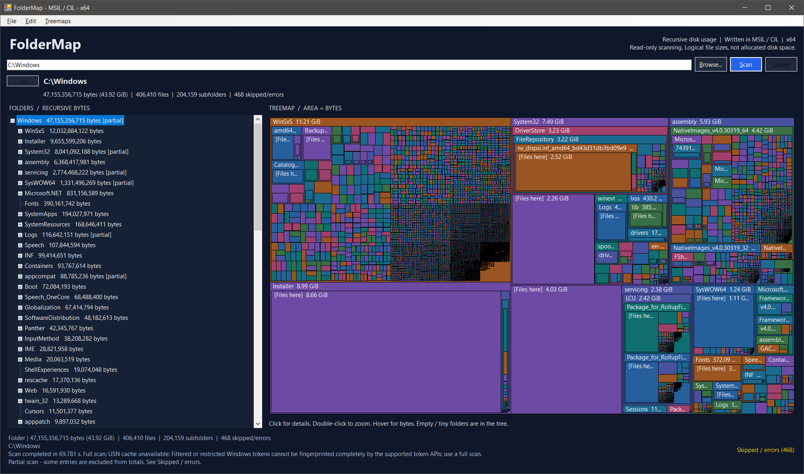

# FolderMap

An **experimential** Windows desktop folder-size explorer written **directly in Microsoft Intermediate
Language (MSIL / CIL)**. The scanner, Windows Forms interface, and treemap are
handwritten IL, not C# compiled or decompiled into IL.

USN rescan cache kind of works, more work needed.



## Build and run

Requires **64-bit Windows and .NET Framework 4.8 or later**. No NuGet packages,
Visual Studio installation, or .NET SDK are needed. The build uses the framework's
64-bit `ILAsm.exe`.

From this directory in PowerShell:

```powershell
powershell.exe -NoProfile -ExecutionPolicy Bypass -File .\build.ps1
.\bin\FolderMap.exe
```

To open and immediately scan a directory:

```powershell
.\bin\FolderMap.exe "C:\Users"
```

The build explicitly uses `/x64 /pe64 /subsystem=2 /highentropyva`. It verifies that
the result is an **AMD64, PE32+, Windows GUI executable**, not AnyCPU or x86.
Keep `bin\FolderMap.exe.config` alongside `bin\FolderMap.exe` when copying the app.

In VS Code, **Ctrl+Shift+B** builds the app. The **Run FolderMap** and
**Test FolderMap** tasks are also available.

## Use

1. Enter a directory path, or choose one with **Browse**.
2. Click **Scan** or press **Enter**. Scanning runs on a background worker.
3. Expand the folder tree to see **exact recursive byte totals**, sorted largest
   first. Selecting any folder updates its summary and treemap.
4. The treemap partitions sibling rectangles in proportion to their bytes.
   Nested rectangles show descendant folders. **[Files here]** represents files
   directly in a folder, separate from its child folders.
5. Select a folder in the tree or **single-click a treemap tile** to show its full
   path, exact bytes, readable size, and counts in the status bar. A selected
   tile gets a white outline; a single click does not zoom. **[Files here]**
   shows only the bytes and file count directly in that folder, not its children.
   Double-click to zoom into the folder; use **Up** or **Alt+Up** to return.
   Hover still shows a tooltip without replacing the selected item's details.
6. Use **F5** to rescan the entered path, or **Cancel / Esc** to stop a scan.
   **File > Full rescan (Ctrl+F5)** bypasses cached directory sizes.
7. Right-click a folder in the tree or a treemap tile and choose **Open in File
   Explorer**. Folder entries open that folder; **[Files here]** opens the folder
   containing those files. The menu targets the item under the pointer, without
   zooming or changing your selection. Unavailable folders and launch errors are
   reported rather than opening a different location.
8. Choose **File > Exit** or press **Alt+F4** to close the app. Exit follows the
   normal window-close behavior, including cancellation of a running scan.
9. If automatic cache checking has been paused for a path, **File > Retry USN
   cache** explicitly re-enables it and starts a new eligibility check.

The divider can be dragged to give the tree or chart more space. Empty folders
remain visible in the tree but have no treemap area. Rectangles smaller than one
pixel, and descendants that no longer fit below a folder caption, are omitted
from that view; select their folder in the tree to zoom in.

Selection details stay visible alongside scan progress, cancellation messages,
and partial-scan warnings. Hover the status text to read the complete details
when a long path does not fit the window. A successful rescan selects its new
root and replaces the previous selection details.

## Persistent NTFS cache

On a supported local NTFS volume with an accessible, active change journal,
the first scan builds a directory snapshot. Later scans use USN records to
identify affected directories: those directories' direct-file sizes and
membership are refreshed, unchanged subtrees are reused, and new or moved-in
subtrees are scanned in full. Known hard-link aliases are tracked so a write
through another containing folder is not ignored.

Snapshots are stored locally under `%LOCALAPPDATA%\FolderMap\Cache`, with
versioned, integrity-checked data and atomic replacement. They contain directory
names, sizes, identities, diagnostics, and pending-change metadata. Nothing is
uploaded. Cache reuse is restricted to the matching volume, root identity,
Windows access context, and retained journal range.

Windows can attach per-process authorization attributes to desktop tokens. When
these differ after an app restart, FolderMap deliberately takes one fresh full
baseline before enabling fast rescans in that process. Saved snapshots are not
trusted across a changed security context. Cache filenames use a stable
per-user/elevation partition so old process-specific files do not accumulate.

Traditional journal access generally requires administrator rights. Use
**File > Restart as administrator...** to request Windows' normal consent prompt
when needed. Elevation is never automatic; cancelling the prompt leaves the
current window open. FolderMap only reads an existing journal: it does not
create, resize, delete, or enable journals, or change filesystem permissions.

While scanning, the status bar explicitly shows **Checking cache**, **Using cache**,
or **Full scan (cache not used)**. That mode stays visible alongside folder
progress and changes when a full-scan fallback is needed. Successful scans,
including partial scans, report their total elapsed time in seconds with
millisecond precision. Cancellation and errors are not labeled as completion.

The status bar also reports cache use and full-scan fallbacks. Full scanning is used
when journal access is unavailable, continuity is lost, the root or access
context changes, records are unsupported, or conservative invalidation is
required (including relevant directory/ancestor security changes and hard-link
membership changes). Ancestor identities are validated as part of cache reuse;
if they cannot be resolved, all security events conservatively force a full scan.
Unrelated security events outside the tree and its ancestors do not invalidate
an otherwise reusable snapshot. Incomplete
directories remain retryable rather than silently becoming complete.

The current Windows SDK storage-class-change reason is recognized as an ordinary
change, not an unknown journal flag. Truly unknown reason bits still cause a safe
fallback, and their hexadecimal values are included in the status explanation.

### When cache reuse helps

Cache reuse requires an eligible local NTFS journal, a matching root/volume and
authorization context, a retained checkpoint, and no invalidating journal
condition. A first baseline is expected to scan everything. Later scans should
report how many directories were reused; a scan that reused zero directories did
not gain that benefit even if it successfully saved a snapshot.

After **two consecutive attempted cache rescans reuse no directories**, FolderMap
pauses USN/cache-metadata work for that path for the current app session. Future
scans obtain fresh sizes without repeatedly rebuilding an unhelpful cache.
Ordinary cold baselines and explicitly forced full scans do not count against the
cache, and a useful cache refresh resets the failure streak. Other paths are not
affected. The status explains the bypass; **File > Retry USN cache** resets it.

Full scans process independent immediate child directories with at most
**min(4, CPU count)** workers. Nested traversal stays sequential within each
worker, root-level files are counted once, and results are merged in stable
order. This bounds I/O concurrency instead of creating one thread per directory;
actual speedup depends on the filesystem, drive, and directory sizes.

**Cached results are last-observed estimates, not a live filesystem snapshot.**
NTFS can coalesce repeated writes while a file stays open. Pending writes seen
in the journal keep their containing directories dirty, but a writer that was
already open before the baseline may not produce another record until close.
Use **Ctrl+F5** when fresh measurements of actively written files are needed.
A full scan is also an observation over time, not an atomic snapshot.

## Treemap layouts and colors

Choose a tiling algorithm from **Treemaps**:

- **Binary** (default): recursively splits the area into balanced groups by size.
- **Squarified**: groups tiles into rows or columns to favor more compact rectangles.
- **Slice and dice**: alternates vertical and horizontal strips at each folder level.

All layouts represent the same byte totals and use the same folder nesting,
selection, zoom, tooltips, and Explorer context menu.

Under **Edit > Colors**, choose **Classic** (the original palette), **Ocean**,
**Forest**, **Sunset**, or **Grayscale**. Each scheme provides eight folder shades
with readable white captions. Files directly in a folder use that folder's color.

The active choices are checkmarked. Changes apply immediately without rescanning
or losing the current zoom or selected item. Choices survive navigation, resizing,
and rescans for the current app session; a new window starts with Binary and
Classic.

## Size and traversal rules

- A folder's total is the sum of the logical lengths of its readable files and
  all scanned descendant files. Counts use checked **64-bit integers**.
- Hidden and system entries are included if readable.
- Sizes are **logical bytes**, not disk allocation or filesystem metadata.
  Sparse/compressed files can occupy less disk space; separate hard-link entries
  are counted separately.
- Descendant reparse points (including junctions and symbolic links) are skipped
  to avoid cycles, duplicate traversal, and leaving the requested tree. A
  reparse-point root is rejected; enter its actual target directory instead.
- Skipped entries, permission failures, and disappearing files are reported.
  Affected folders are marked **[partial]**. **Skipped / errors** shows the first
  200 diagnostics while the count includes all issues.
- Invalid root paths fail explicitly. Cancellation and failed scans preserve the
  previous completed result. Cancellation takes effect between filesystem calls;
  an unresponsive network share can delay the current call.
- Traversal and treemap layout use explicit stacks, and tree controls are created
  only for expanded branches. The scan retains folder metadata, not file contents
  or a node for every file.
- The runtime configuration enables modern .NET Framework long-path handling.
  Remaining filesystem/provider errors are reported rather than silently ignored.
- This is a read-only, point-in-time observation of a changing filesystem, not an
  atomic snapshot. Rescan to refresh sizes.

## Verify

Run in **64-bit Windows PowerShell 5.1**, not PowerShell 7 (`pwsh`):

```powershell
powershell.exe -NoProfile -STA -ExecutionPolicy Bypass -File .\tests\run-tests.ps1
```

The dependency-free tests verify the PE/assembly architecture and runtime
metadata, JIT-compile IL methods to detect invalid stacks/signatures, exercise the
scanner against temporary fixtures, check weighted layout geometry and deep
trees, and open a real Windows Forms window to test rendering, navigation,
background scanning, cancellation, and rescanning. An additional smoke test launches
the compiled executable, verifies command-line path handling, and checks its exit
code. It also rescans through UI Automation when the desktop exposes the button's
Invoke pattern. Environment-dependent skips are reported explicitly.

To also verify the context-menu actions against real File Explorer windows:

```powershell
powershell.exe -NoProfile -STA -ExecutionPolicy Bypass -File .\tests\explorer.tests.ps1 -Launch
```

These checks open temporary test folders with spaces, punctuation, and Unicode
names. Cleanup closes only newly created Explorer windows still showing those
test folders; existing Explorer windows are left alone.

The GUI tests briefly show a window. For a machine without an interactive desktop:

```powershell
powershell.exe -NoProfile -ExecutionPolicy Bypass -File .\tests\run-tests.ps1 -SkipGui
```

For read-only live journal and cache verification, run these from an
administrator PowerShell session:

```powershell
powershell.exe -NoProfile -STA -ExecutionPolicy Bypass -File .\tests\usn.tests.ps1 -Live
powershell.exe -NoProfile -STA -ExecutionPolicy Bypass -File .\tests\cache-live.tests.ps1
```

These tests modify only disposable fixtures and never enable or alter journals.
They verify real size-change detection, selective refresh, rebaselining after a
changed process authorization context, corrupt-cache recovery, and cancellation.

## Source

- [FolderMap.il](FolderMap.il): assembly metadata, references, and STA entry point.
- [Scanner.il](src/Scanner.il): iterative filesystem traversal and folder totals.
- [ParallelScanner.il](src/ParallelScanner.il): bounded parallel full scans across immediate child directories.
- [NtfsJournal.il](src/NtfsJournal.il): read-only NTFS identities, journal parsing, and token-context verification.
- [CacheStore.il](src/CacheStore.il): bounded, versioned snapshot serialization and atomic persistence.
- [CacheModels.il](src/CacheModels.il): cache records and scan-observer contracts.
- [CacheRecorder.il](src/CacheRecorder.il): identity, diagnostic, and hard-link metadata capture.
- [CacheAncestors.il](src/CacheAncestors.il): ancestor identity validation for scoped security invalidation.
- [CachePolicy.il](src/CachePolicy.il): per-path adaptive bypass and explicit retry after unproductive cache attempts.
- [CachedScanner.il](src/CachedScanner.il): cache validation, journal refresh orchestration, and full-scan fallbacks.
- [CacheRefresh.il](src/CacheRefresh.il): shallow refresh and unchanged-directory reuse.
- [CacheDelta.il](src/CacheDelta.il): conservative journal invalidation and pending-write tracking.
- [CacheTree.il](src/CacheTree.il): validated cache paths and independent folder-tree reconstruction.
- [Elevation.il](src/Elevation.il): user-initiated administrator restart.
- [Treemap.il](src/Treemap.il): weighted binary layout, rendering, and hit testing.
- [Tiling.il](src/Tiling.il): squarified and slice-and-dice tiling.
- [Appearance.il](src/Appearance.il): layout choices and readable tile palettes.
- [Explorer.il](src/Explorer.il): validated folder targets and Windows shell activation.
- [MainForm.il](src/MainForm.il): Windows Forms controls and background scan lifecycle.
- [build.ps1](build.ps1): reproducible x64 assembly and PE header checks.
- [tests](tests/): PowerShell verification; no test framework installation required.
